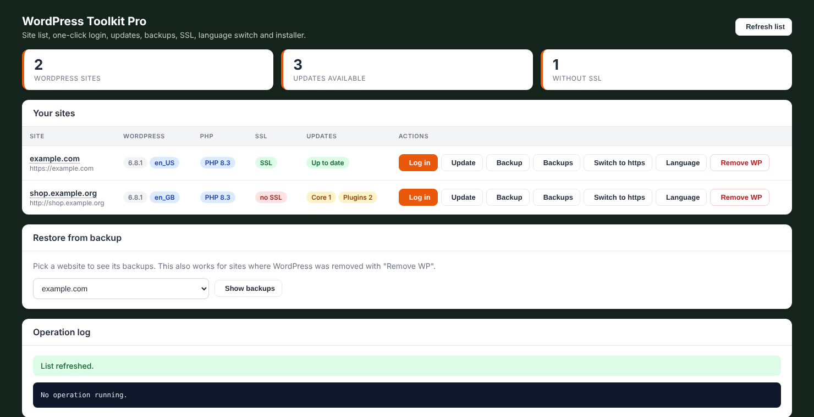

# WordPress Toolkit Pro for CyberPanel

A free, open-source plugin for [CyberPanel](https://cyberpanel.net/) (OpenLiteSpeed) that adds a **WordPress manager** to the panel's sidebar: one screen to see all your WordPress sites, log in without a password, update, back up, restore, switch language, move to https, remove, and install new sites.

> **Status: beta.** Built and used on a single-server setup (Ubuntu 24.04, CyberPanel 3.0.x). Test on a non-critical site first and keep your own server snapshots. See [Limitations](#limitations).



## Features

| Feature | What it does |
|---|---|
| **Site list** | Finds every WordPress install under `/home/*/public_html`; shows WordPress version, language, PHP, SSL and available updates (core / plugins / themes). |
| **One-click login** | Creates a single-use wp-admin link valid for 2 minutes. No password needed. |
| **Update** | Safety backup, then core + database + plugins + themes + language packs, then LiteSpeed cache purge. |
| **Backup** | Database dump + full `public_html` archive (`.tar.gz`), last 7 kept per site. |
| **Restore** | Restore any backup (also for a site whose WordPress was removed); a safety backup of the current state is taken first. |
| **Switch to https** | After you issue a certificate in CyberPanel: rewrites `http://` to `https://` in the database and adds an http→https redirect. Refuses self-signed certificates. |
| **Language** | Switches the WordPress language (core, plugins, themes) and resets per-user languages. |
| **Remove WP** | Deletes the files, database and DB user of a site (the website stays in CyberPanel). Needs the domain typed as confirmation; a backup is taken first. |
| **Installer** | Installs a fresh WordPress (random DB name/user/password, generated admin password, optional LiteSpeed Cache). Rolls back on failure. |

## Requirements

* CyberPanel 3.0.x with OpenLiteSpeed, and root SSH access to the server
* Ubuntu 24.04 (the only setup tested so far)
* An `lsphp` binary (CyberPanel ships them), MariaDB, `openssl`, `tar`, `flock`
* [WP-CLI](https://wp-cli.org/) at `/usr/local/bin/wp` (downloaded automatically on first install if missing)

## Quick install

On the server, as root (replace the URL with the release you want):

```bash
cd /usr/local/CyberCP
curl -fL -o wordpressToolkitPro.zip \
  https://github.com/ravxvx/cyberpanel-wordpress-toolkit-pro/releases/latest/download/wordpressToolkitPro.zip
PYTHONPATH=/usr/local/CyberCP /usr/local/CyberCP/bin/python \
  pluginInstaller/pluginInstaller.py install --pluginName wordpressToolkitPro
rm -f /usr/local/CyberCP/wordpressToolkitPro.zip
```

Wait a few seconds (the panel restarts itself), refresh the panel with Ctrl+F5 and open **WP Toolkit Pro** in the left sidebar.
The zip file **must** be named `wordpressToolkitPro.zip`. Full instructions, updating and removing: [docs/INSTALL.md](docs/INSTALL.md).

## Documentation

* [Installation, update, removal](docs/INSTALL.md)
* [Using the plugin](docs/USAGE.md)
* [Troubleshooting](docs/TROUBLESHOOTING.md)
* [How it works / architecture](docs/ARCHITECTURE.md)
* [Security notes](SECURITY.md)
* [Changelog](CHANGELOG.md)

## Limitations

* Only sites with WordPress in `/home/<domain>/public_html` are listed (child/sub-domains created inside another site's `public_html` are not).
* Backups are stored on the **same server** (`/home/wptoolkit-backups/`). Copy them off-server for real disaster recovery.
* A CyberPanel upgrade can overwrite the sidebar template and remove the menu link; run `sh /usr/local/CyberCP/wordpressToolkitPro/repair-menu.sh` and `systemctl restart lscpd`.
* The user interface is in English only.
* Not affiliated with CyberPanel, LiteSpeed or WordPress.

## Contributing

Issues and pull requests are welcome. Please describe your CyberPanel version, OS and the output shown in the plugin's "Operation log" when reporting a bug. See [docs/ARCHITECTURE.md](docs/ARCHITECTURE.md) for the code layout and `scripts/build-zip.sh` to build a release zip.

## License

[MIT](LICENSE)
