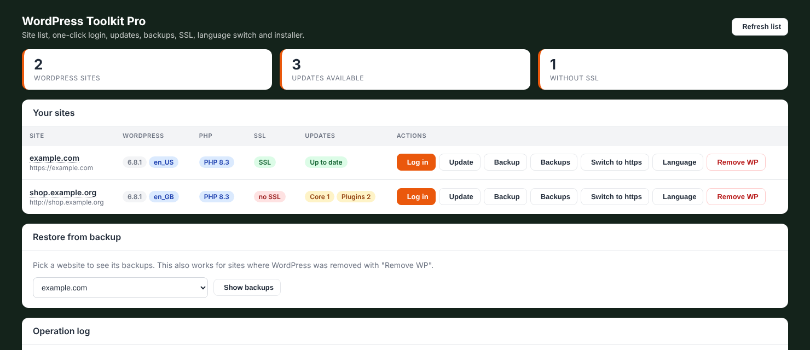
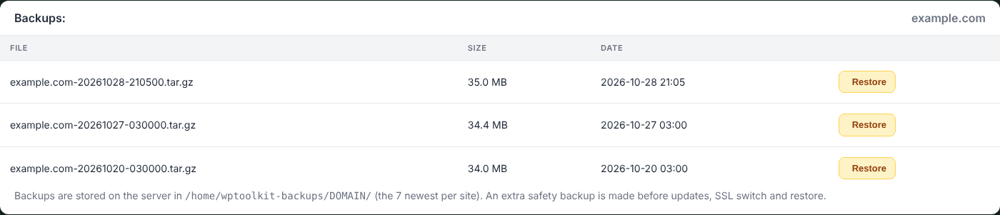
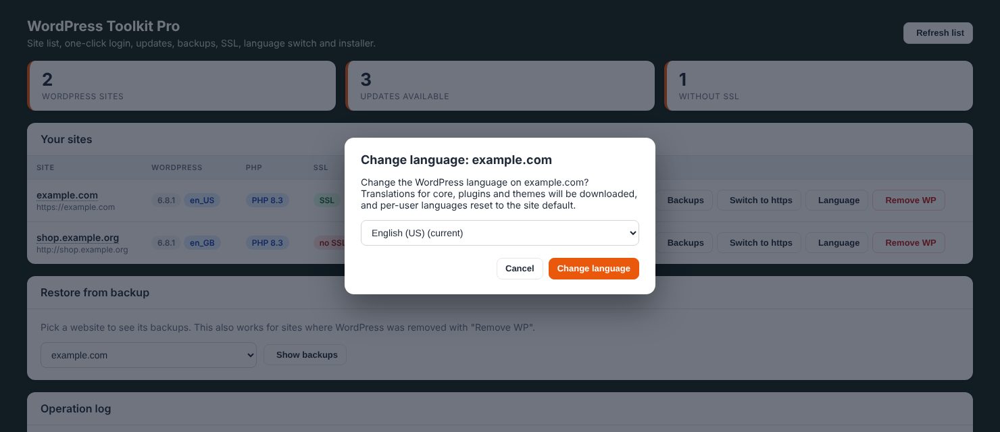
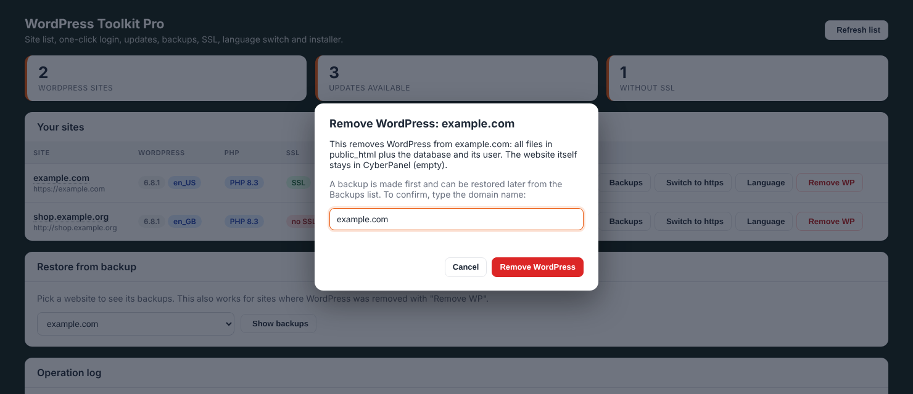

# WordPress Toolkit Pro for CyberPanel

**A practical WordPress management toolkit built into CyberPanel.**

Manage WordPress installations from one place: inspect sites, run updates, create and restore backups, manage plugins and themes, review logs, and perform common maintenance tasks without leaving CyberPanel.

> **Project status: Beta.** Tested on a limited CyberPanel setup. Always take a server snapshot and test on a non-critical site before using it in production. See [Limitations](#limitations).



## At a glance

- **Manage sites:** discover WordPress installations and review their versions, PHP, SSL and available updates.
- **Work faster:** open wp-admin with a temporary, single-use login link.
- **Protect your sites:** create backups, restore a previous state and schedule recurring backups.
- **Maintain WordPress:** update core, plugins, themes and language packs; clear caches and clean database clutter.
- **Troubleshoot:** inspect error logs, check file integrity and use maintenance mode.
- **Install and remove:** install a fresh WordPress site or remove an installation with confirmation and a safety backup.

## Screenshots

The screenshots below are existing feature previews from the project. They illustrate the toolkit's workflows; they are not a claim that every screen reflects the current 3.9.0 Modern Light interface.

| Dashboard | Backups & restore |
|:---:|:---:|
|  |  |
| **Language management** | **Safe removal** |
|  |  |

## Features

| Area | Capabilities |
|---|---|
| Site overview | Finds WordPress installations under /home/*/public_html; displays WordPress version, language, PHP, SSL and available core/plugin/theme updates. |
| One-click login | Creates a single-use wp-admin link valid for 2 minutes. |
| Updates | Takes a safety backup, updates WordPress core, database, plugins, themes and language packs, then purges LiteSpeed cache. |
| Backups | Creates a database dump and full public_html archive (.tar.gz); keeps the latest 7 per site by default. |
| Restore | Restores a selected backup, including for a site whose WordPress files were removed; takes a safety backup first. |
| HTTPS | Rewrites site URLs to HTTPS and adds a redirect after a valid certificate has been issued in CyberPanel. |
| Languages | Changes the WordPress language, including core, plugins and themes. |
| Plugins and themes | Activate, deactivate and update; temporarily deactivate all plugins for troubleshooting. |
| Logs and diagnostics | Review available web-server, WordPress and PHP logs and run the toolkit's diagnostic checks. |
| Maintenance | Toggle maintenance mode, check file integrity, manage administrators and reset passwords. |
| Cleanup | Clear caches and remove revisions, spam/trash comments and expired transients. |
| Installer | Installs WordPress with generated database credentials and an admin password; rolls back on failure. |

## Requirements

- CyberPanel 3.0.x with OpenLiteSpeed and root SSH access
- Ubuntu 24.04 (the currently tested environment)
- CyberPanel lsphp binary, MariaDB, openssl, tar and flock
- WP-CLI at /usr/local/bin/wp (downloaded automatically on first install if missing)

## Installation

Take a server snapshot before installing or updating. Run the commands below as **root**.

### 1. Download the release ZIP

Place the file at /usr/local/CyberCP/wordpressToolkitPro.zip.

```bash
cd /usr/local/CyberCP
curl -fL -o wordpressToolkitPro.zip \
  https://github.com/ravxvx/cyberpanel-wordpress-toolkit-pr/releases/latest/download/wordpressToolkitPro.zip
```

Alternatively, upload the ZIP from your computer:

```powershell
scp .\wordpressToolkitPro.zip root@SERVER_IP:/root/wpt.zip
```

Then, on the server:

```bash
cp /root/wpt.zip /usr/local/CyberCP/wordpressToolkitPro.zip
```

### 2. Check the archive

```bash
unzip -l /usr/local/CyberCP/wordpressToolkitPro.zip | grep wptool
```

### 3. Install

```bash
cd /usr/local/CyberCP
PYTHONPATH=/usr/local/CyberCP /usr/local/CyberCP/bin/python \
  pluginInstaller/pluginInstaller.py install --pluginName wordpressToolkitPro
```

The installer should finish with **Plugin successfully installed**. CyberPanel may restart its panel service a few seconds later.

### 4. Open the plugin

Refresh CyberPanel with **Ctrl+F5** and select **WP Toolkit Pro** from the CyberPanel left sidebar, or open:

https://SERVER_IP:8090/wordpressToolkitPro/

## Updating and removing

For the update/removal procedure and troubleshooting steps, see:

- [Installation, update and removal guide](docs/INSTALL.md)
- [Troubleshooting](docs/TROUBLESHOOTING.md)

Updating the plugin should not remove your WordPress sites or stored backups. Always retain an independent server backup before changing production software.

## Documentation

- [Using the plugin](docs/USAGE.md)
- [Architecture](docs/ARCHITECTURE.md)
- [Security notes](SECURITY.md)
- [Changelog](CHANGELOG.md)

## Limitations

- Only WordPress installations under /home/<domain>/public_html are discovered. Child or subdomains installed inside another site's public_html may not appear.
- Backups are stored on the same server in /home/wptoolkit-backups/. Copy them off-server for disaster recovery.
- A CyberPanel upgrade may overwrite its sidebar template and remove the plugin menu entry. The menu can be repaired with sh /usr/local/CyberCP/wordpressToolkitPro/repair-menu.sh, followed by systemctl restart lscpd.
- The interface is currently English-only.
- This project is independent and is not affiliated with CyberPanel, LiteSpeed or WordPress.

## Contributing

Issues and pull requests are welcome. When reporting a problem, include your CyberPanel version, operating system and the relevant output from the plugin's operation log. See [Architecture](docs/ARCHITECTURE.md) for the code layout and scripts/build-zip.sh for building a release archive.

## License

[MIT](LICENSE)
